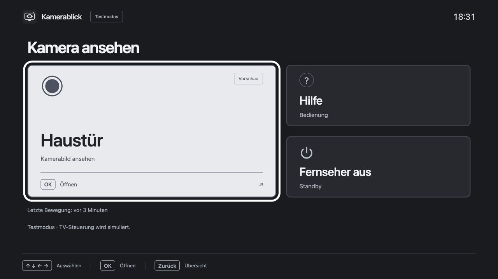
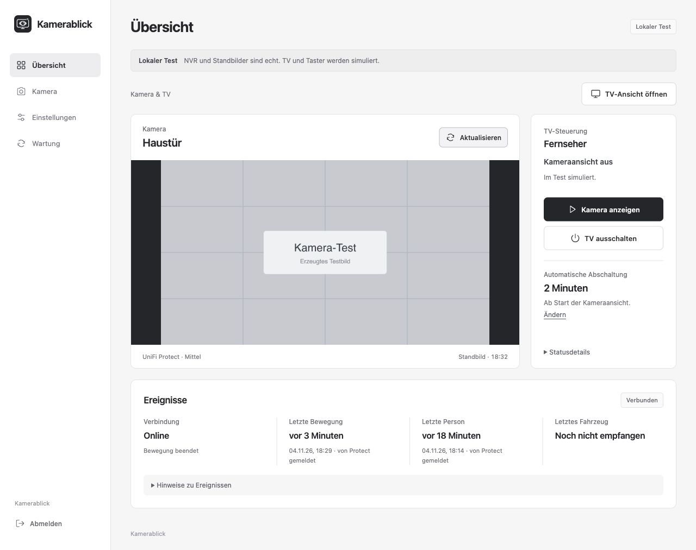
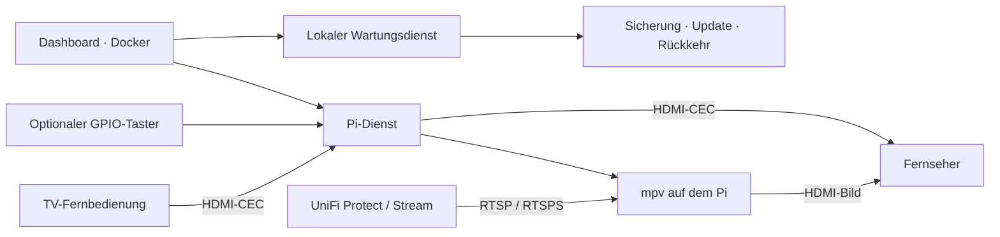

<p align="center">
  
</p>

<p align="center">
  <a href="https://github.com/loserat/kamerablick/actions/workflows/checks.yml"></a>
  <a href="https://github.com/loserat/kamerablick/releases/tag/v0.1.14"></a>
  <a href="docs/ABNAHME.md"></a>
</p>

<p align="center">
  <strong>Kameras auf dem Fernseher. Mit der Fernbedienung auswählen.</strong><br>
  Raspberry Pi · UniFi Protect · Docker · HDMI-CEC
</p>

<p align="center">
  <a href="docs/PI4.md">Pi vorbereiten</a> ·
  <a href="docs/INSTALLATION.md">Installieren</a> ·
  <a href="docs/BEDIENUNG.md">Bedienung</a> ·
  <a href="docs/README.md">Dokumentation</a> ·
  <a href="https://github.com/loserat/kamerablick/releases">Releases</a>
</p>

## Wofür Kamerablick gedacht ist

Meine Oma soll nachsehen können, wer vor der Tür steht: eine Kamera mit den Pfeiltasten auswählen, mit **OK** öffnen und mit **Zurück** wieder zur Auswahl wechseln. Große Schrift, eine helle Auswahlmarkierung und wenige Bedienelemente machen die TV-Ansicht übersichtlich. Für das Ausschalten gibt es eine eigene Bestätigung.

Ein separates Dashboard im Browser übernimmt Kameraeinrichtung, Passwort, Abschaltzeit und App-Updates. Optional kann ein GPIO-Taster am Pi die Kamera öffnen und den Fernseher wieder ausschalten.

**Aktuelles Release: v0.1.14.** Es bündelt die überarbeitete Dokumentation und aktualisierte Versionsverweise. Der dokumentierte Gerätetest bezieht sich auf v0.1.13; ein eigener Test von v0.1.14 auf dem Pi steht noch aus.

## Am echten Gerät geprüft

**Prüfaufbau: Raspberry Pi 4 Model B mit 64-Bit-System und Philips 55PUS6581/12.** Am 06.11.2026 wurden der automatische Start, der direkte Dashboard-Zugriff über die Pi-IP und der HDMI-CEC-Tastenempfang geprüft. Die Bedienung mit der echten Philips-Fernbedienung wurde vom Benutzer bestätigt.

Drei veröffentlichte App-Updates bis **v0.1.13** liefen über die Wartungsseite erfolgreich durch. Kameraeinstellungen und TV-Kopplung blieben erhalten. Die Passwortänderung wurde über die authentifizierte App-Schnittstelle geprüft; Anmeldung und Beständigkeit nach einem Containerneustart wurden bestätigt.

| Prüfbereich | Ergebnis |
| --- | --- |
| Pi-Start, Dashboard, Pi-Dienst, Kiosk und Wartungsdienst | Am echten Pi bestätigt; Installationsdiagnose erfolgreich. |
| Fernbedienung am Philips 55PUS6581/12 | Echte CEC-Tasten und sichtbarer Auswahlwechsel bestätigt. |
| Updates über die Pi-IP | v0.1.10 → v0.1.11 → v0.1.12 → v0.1.13 erfolgreich installiert. |
| Passwort, Anmeldung und Datenerhalt | Am Pi einschließlich Containerneustart geprüft. |
| Softwareprüfung von v0.1.13 | 159 Python-Tests und 40 JavaScript-Prüfungen in Linux-CI erfolgreich. |
| Docker-Veröffentlichung | ARM64, ARMv7 und AMD64 veröffentlicht; ARM64 anonym heruntergeladen und geprüft. |

**Noch am Ziel zu prüfen:** echtes Protect-Livebild und Ereignisse, Wechsel aus dem echten Player mit der neuen Kameraauswahl, verdrahteter GPIO-Taster, Standby-/Abschaltzyklen und VPN aus einem fremden Netz. Der bestätigte Philips-Test gilt für die oben genannten Funktionen; andere TV-Modelle sind nicht automatisch mitverifiziert. [Prüfprotokoll und genaue Grenzen →](docs/ABNAHME.md)

## Zwei Ansichten

### Am Fernseher

Höchstens zwei große Kamerakacheln nebeneinander. Pfeile wählen aus, **OK** öffnet das Bild und **Zurück** führt zur Auswahl. Die zuletzt gewählte Kamera bleibt fokussiert. Es wird jeweils ein Kamerabild gezeigt. Die Darstellung wurde mit vier Beispielkameras bei HD, Full HD und 4K im Browser geprüft.



### Im Browser

Unter **Kameras** den NVR verbinden, eine Kamera auswählen und den Stream einrichten. Weitere Protect-Kameras und eigene RTSP-/RTSPS-Streams lassen sich am TV auswählen. Unter **Einstellungen** Abschaltzeit und Dashboard-Passwort ändern; unter **Wartung** Verbindungen und Updates prüfen.



*Die Abbildungen zeigen Testdaten. Sie enthalten keine privaten Kamerabilder oder Zugangswerte.*

## Auf dem Pi installieren

Voraussetzung ist ein **Raspberry Pi 4B mit Raspberry Pi OS (64 Bit) und Desktop**, eingerichtetem Netzwerk, Desktop-Autologin, Docker Engine mit Compose v2 sowie den benötigten TV-/GPIO-Programmen. Die Vorbereitung steht im [Pi-4-Schnellstart](docs/PI4.md). Ein CEC-fähiger Fernseher, ein Micro-HDMI-Kabel und eine erreichbare Kamera beziehungsweise Protect-Zentrale gehören zum Aufbau.

Als normaler Desktop-Benutzer:

```sh
git clone --branch v0.1.14 https://github.com/loserat/kamerablick.git ~/kamerablick
cd ~/kamerablick
sudo loginctl enable-linger "$USER"
python3 pi/install.py --check
```

Fehlende Voraussetzungen zuerst ergänzen. Danach:

```sh
python3 pi/install.py --install --image ghcr.io/loserat/kamerablick:v0.1.14
```

Das öffentliche Docker-Image lässt sich ohne GitHub-Anmeldung laden. Docker wählt die passende Prozessorvariante; ein lokaler Image-Bau ist nicht nötig. Dashboard und versionierte Pi-Laufzeit werden gemeinsam eingerichtet.

Im Heimnetz **`http://PI-IP:8088`** öffnen. Das anfängliche Dashboard-Passwort steht ausschließlich lokal in `~/kamerablick/.env`. Es lässt sich unter **Einstellungen → Dashboard-Passwort ändern** ändern; danach gilt das neu gesetzte Passwort. Es gibt kein allgemeines Standardpasswort.

[Installation und Diagnose →](docs/INSTALLATION.md) · [Ohne Pi am eigenen NVR vortesten →](docs/HEIMTEST.md)

## App-Updates ohne SSH-Befehl

1. Das Dashboard über die Pi-IP öffnen und anmelden.
2. Unter **Wartung → Version prüfen** die installierte und angebotene GitHub-Version vergleichen.
3. Bei einer neueren Version **Jetzt aktualisieren → Sichern und aktualisieren** bestätigen.
4. Den Abschluss abwarten, bei Bedarf neu anmelden und das Dashboard neu laden.

Sind beide Versionen gleich, ist die Installation aktuell und der Updateknopf wird nicht angezeigt. Eine Änderung auf GitHub allein erzeugt kein App-Update: Dafür wird ein neues Release mit Docker-Image veröffentlicht.

Vor dem Wechsel werden die Einstellungen gesichert. Der Auftrag läuft auf dem Pi weiter, auch wenn das Dashboard neu startet. Ergebnis und Zeitpunkt stehen unter **Letzter Updateversuch**. Betriebssystem, Docker, Firmware und VPN werden separat gepflegt. [Updateablauf, ältere Installationen und Rückweg →](docs/BROWSER-UPDATES.md)

## Funktionen und Grenzen

| Funktion | Umfang |
| --- | --- |
| UniFi Protect | Lokaler UniFi-Benutzer oder API-Schlüssel, Zertifikatprüfung, Kameraauswahl, Standbild und Stream-Freigabe. Kein ui.com-/MFA-Login. |
| Mehrere Kameras | Protect-Kameras und bis zu 24 eigene RTSP-/RTSPS-Streams speichern; jeweils eine Kamera wiedergeben. |
| Große TV-Ansicht | Pfeile, OK, Zurück, sichtbarer Fokus und Ausschaltbestätigung; CEC-Empfang über den Pi-Dienst. |
| GPIO und Abschaltzeit | Optionaler Taster und automatische Abschaltung; Verdrahtung und Alltagsbetrieb gesondert prüfen. |
| Kamera und Ereignisse | Status sowie letzte empfangene Bewegung, Person und Fahrzeug; abhängig von Protect-Rechten, API und Kamerafähigkeiten. |
| Wiedergabeüberwachung | Stockende Streams erkennen und mit begrenztem Abstand erneut verbinden. |
| Zugriff im Heimnetz | Passwortgeschütztes Dashboard direkt über die Pi-IP. Livevideo läuft auf dem Pi, das Dashboard zeigt Status und Standbilder. |
| Zugriff von unterwegs | Über ein separat eingerichtetes privates VPN; kein eingebauter Cloud-Fernzugang. |

## Aufbau



Das Dashboard hat keinen Docker-Socket und keinen direkten GPIO-/CEC-Gerätezugriff. Pi-Dienst, TV-Browser, Player und Wartung laufen auf dem Host. Lokale Dienstports bleiben auf Loopback beschränkt; das Dashboard ist im Heimnetz erreichbar. Für Zugriff von unterwegs ein VPN verwenden. [Architektur und Datenhaltung →](docs/ARCHITEKTUR.md)

## Dokumentation

| Thema | Anleitung |
| --- | --- |
| Alle Anleitungen im Überblick | [Dokumentationsindex](docs/README.md) |
| Pi mit WLAN vorbereiten | [Pi 4B](docs/PI4.md) |
| Installieren und Diagnose ausführen | [Installation](docs/INSTALLATION.md) |
| Kameras einrichten, bedienen und Passwort ändern | [Bedienung](docs/BEDIENUNG.md) |
| NVR vor dem Pi-Einsatz testen | [Heimtest](docs/HEIMTEST.md) |
| Aktualisieren und wiederherstellen | [Browser-Updates](docs/BROWSER-UPDATES.md) |
| Philips, HDMI-CEC und Tastenempfang | [Fernbedienung](docs/FERNBEDIENUNG.md) |
| Typische Fehler gezielt lösen | [Fehlersuche](docs/FEHLERSUCHE.md) |
| Sicherungen und Speicherpflege | [Wartung](docs/WARTUNG.md) |
| Ereignisse und Aktualität | [Telemetrie](docs/TELEMETRIE.md) |
| VPN vorbereiten und prüfen | [Fernzugriff](docs/FERNZUGRIFF.md) |
| Gerätetest, Softwaretests und offene Punkte | [Prüfprotokoll](docs/ABNAHME.md) |
| Öffentliche Dateien und schlanke Docker-Pakete | [Repository und Auslieferung](docs/REPOSITORY.md) |
| Quellcode, lokale Tests und Beiträge | [Entwicklung](docs/ENTWICKLUNG.md) · [Beitragen](CONTRIBUTING.md) |
| Ältere Hardware mit LAN | [Pi 2B als Alternative](docs/PI2.md) |
| Änderungen je Version | [Changelog](CHANGELOG.md) |

Fehler und Vorschläge gehören in ein [Issue](https://github.com/loserat/kamerablick/issues). Zugangswerte, Stream-Adressen und private Kamerabilder vorher entfernen. Sicherheitsprobleme nach [SECURITY.md](SECURITY.md) melden.

Kamerablick ist ein unabhängiges Projekt und steht in keiner Verbindung zu Ubiquiti, Raspberry Pi oder Philips.
