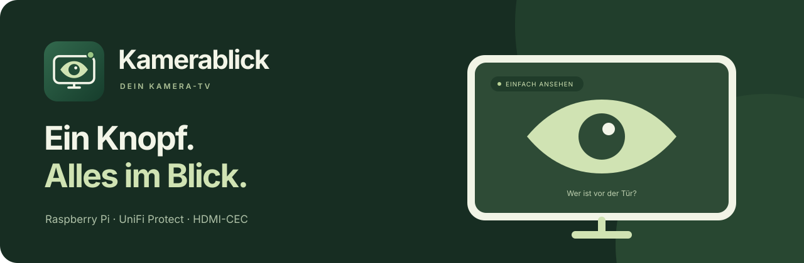
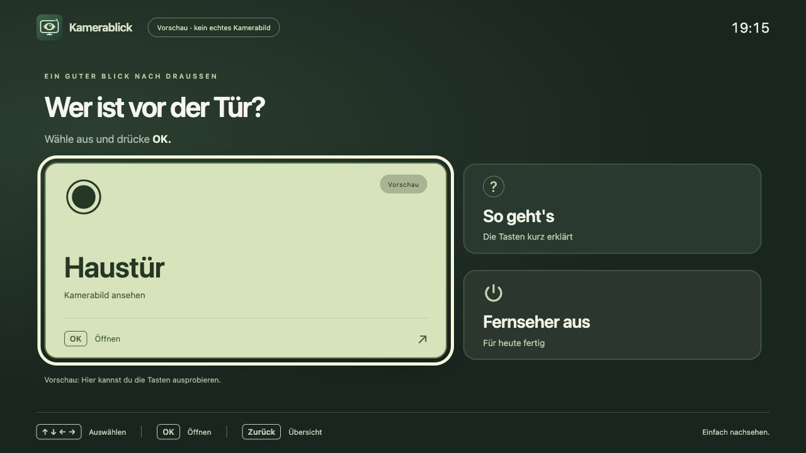
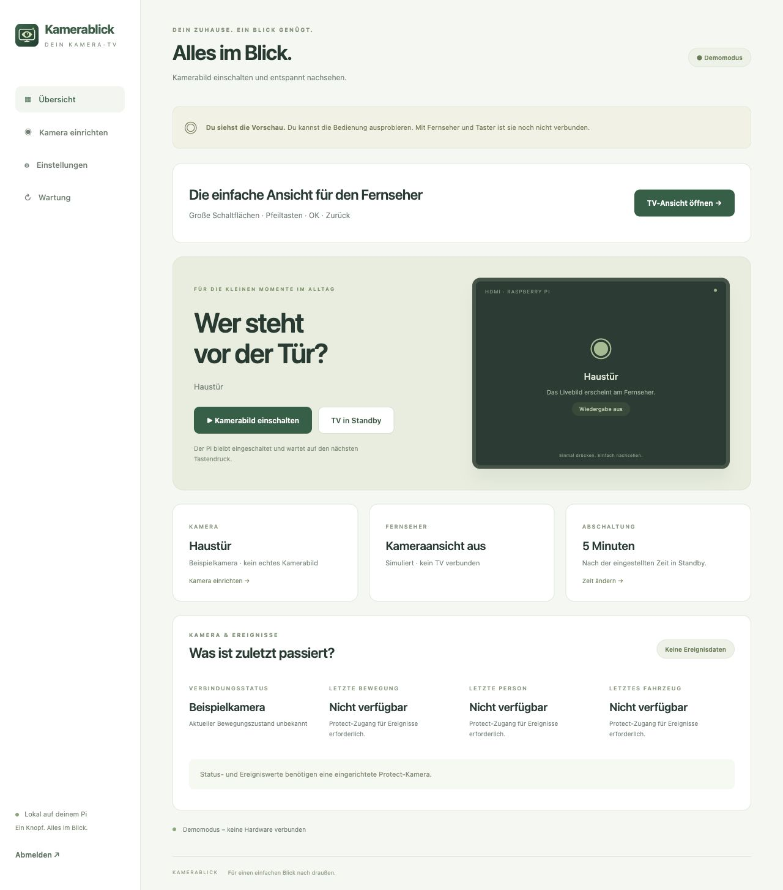
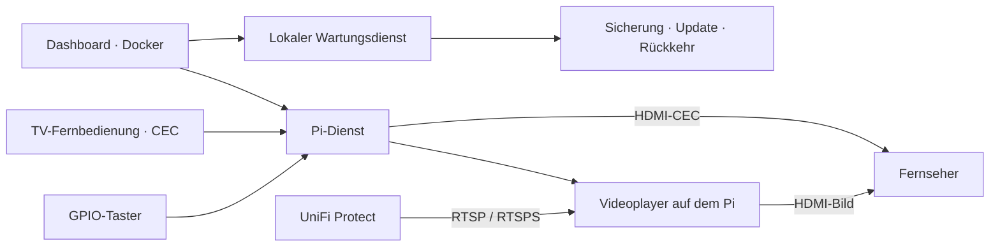

<p align="center">
  
</p>

<p align="center">
  <a href="https://github.com/loserat/kamerablick/actions/workflows/checks.yml"></a>
  <a href="https://github.com/loserat/kamerablick/releases"></a>
  
  
</p>

<p align="center">
  <strong>Deine Kamera auf dem Fernseher. Einfach genug für den Alltag.</strong><br>
  Raspberry Pi · UniFi Protect · HDMI-CEC · Docker
</p>

<p align="center">
  <a href="docs/HEIMTEST.md">Zu Hause testen</a> ·
  <a href="docs/PI4.md">Pi einrichten</a> ·
  <a href="docs/INSTALLATION.md">Installieren</a> ·
  <a href="https://github.com/loserat/kamerablick/releases">Releases</a> ·
  <a href="https://github.com/loserat/kamerablick/issues">Feedback</a>
</p>

## Einmal drücken. Einfach nachsehen.

Kamerablick entstand für meine Oma: Sie soll sehen können, wer vor der Tür steht, ohne eine App zu suchen oder ein Kamerasystem bedienen zu müssen.

Ein Taster am Raspberry Pi schaltet den Fernseher ein und öffnet die eingerichtete Kamera. Der nächste Druck schickt den TV in Standby. Alternativ gibt es eine übersichtliche TV-Ansicht mit großen Schaltflächen, sichtbarem Fokus und Pfeiltasten-/OK-Bedienung. Einrichtung und Wartung erledigst du im separaten Dashboard.

> **Stand:** Software und Docker-Images sind veröffentlicht und lokal geprüft. Die Inbetriebnahme am echten Pi 4B, an Protect und am Fernseher steht noch aus. Welche TV-Fernbedienung funktioniert, hängt vom HDMI-CEC-Empfang des Fernsehers ab. [Prüfstand und Grenzen →](docs/ABNAHME.md)

## Zwei Ansichten. Für zwei Aufgaben.

### Für den Fernseher

Große Kacheln für Kamera, kurze Hilfe und Ausschalten mit Bestätigung. Pfeile wählen aus, **OK** öffnet, **Zurück** führt zur Übersicht.



### Für die Einrichtung

Am lokalen NVR mit UniFi-Benutzer oder API-Schlüssel anmelden, Kamera auswählen, Standbild prüfen und übernehmen. Die Stream-Adresse wird automatisch ermittelt. Danach lassen sich Taster, Abschaltzeit und Kamerastatus zentral einstellen beziehungsweise prüfen.



*Beide Abbildungen zeigen den lokalen Demomodus. Es werden keine echten Kamerabilder oder privaten Zugangsdaten gezeigt.*

## Das steckt drin

| Funktion | Was sie macht |
| --- | --- |
| **UniFi Protect einrichten** | Lokaler UniFi-Benutzer oder API-Schlüssel; Kamera und Bildqualität im Assistenten auswählen. |
| **Manuell hinzufügen** | Einen vorhandenen RTSP-/RTSPS-Stream direkt als aktive Kamera speichern. |
| **Zu Hause vortesten** | Echter NVR-Zugang und Standbild, getrennte Daten und simulierte TV-/GPIO-Aktionen. |
| **Taster und TV** | GPIO-Taster, HDMI-CEC für Einschalten/Standby und einstellbare automatische Abschaltung. |
| **Einfache TV-Bedienung** | Pfeiltasten, OK, Zurück; CEC-Empfänger für die TV-Fernbedienung vorbereitet. |
| **Kamera und Ereignisse** | Verbindungsstatus sowie letzte empfangene Bewegung, Person und Fahrzeug mit erkennbarer Aktualität. |
| **Wiedergabe überwachen** | Festhängende Streams erkennen und mit wachsendem Abstand erneut verbinden. |
| **Updates im Browser** | Stabile GitHub-Version prüfen, Installation bestätigen, Einstellungen sichern und nach Startfehlern zurückkehren. |
| **Im Browser öffnen** | Passwortgeschütztes Dashboard direkt über die Pi-IP im Heimnetz öffnen. Fernzugriff über ein separat eingerichtetes VPN. |

Aktuell zeigt die TV-Ansicht **eine ausgewählte Kamera**. Der Videoplayer läuft direkt auf dem Pi; das Dashboard zeigt Status und Standbilder.

## Erst zu Hause ausprobieren

Der Heimtest verbindet deinen eigenen NVR, bevor Pi und Fernseher eingerichtet sind. Anmeldung, Kamerawahl, Standbild und eine erneute Verbindungsprüfung erfolgen in der Oberfläche. Es werden keine TV- oder GPIO-Befehle gesendet. [Heimtest starten →](docs/HEIMTEST.md)

## Auf deinem Pi starten

Empfohlenes Ziel ist ein **Raspberry Pi 4B mit WLAN und Raspberry Pi OS (64 Bit) mit Desktop**. Du brauchst außerdem eine SD-Karte, geeignetes Netzteil, Micro-HDMI-Kabel, einen CEC-fähigen TV und eine erreichbare Protect-Zentrale mit lokalem Benutzer oder API-Schlüssel.

Zuerst [Betriebssystem, WLAN, Docker und benötigte Programme einrichten](docs/PI4.md). Anschließend als normaler Desktop-Benutzer:

```sh
git clone --branch v0.1.4 https://github.com/loserat/kamerablick.git ~/kamerablick
cd ~/kamerablick
python3 pi/install.py --check
```

Fehlende Voraussetzungen zuerst ergänzen. Danach installieren:

```sh
sudo loginctl enable-linger "$USER"
python3 pi/install.py --install --image ghcr.io/loserat/kamerablick:v0.1.4
```

Das öffentliche Image benötigt keine GitHub-Anmeldung. Docker wählt automatisch **ARM64**, **ARMv7** oder **AMD64** passend zum installierten System. Die Pi-Laufzeit wird aus derselben Image-Version übernommen.

Nach der Installation im selben Heimnetz **`http://PI-IP:8088`** im Browser öffnen. Das neu erzeugte Dashboard-Passwort steht auf dem Pi in `~/kamerablick/.env`. Der Laptop-Heimtest bleibt standardmäßig auf dem eigenen Rechner erreichbar.

## Bereits installiert?

Vorhandene Installationen bis v0.1.3 benötigen einmalig den neuen Pi-Wartungsdienst. Danach lassen sich neue Versionen unter **Wartung → Jetzt aktualisieren** installieren. [Vorhandene Installation umstellen →](docs/BROWSER-UPDATES.md)

## So arbeiten die Teile zusammen



Das Dashboard läuft ohne privilegierten Gerätezugriff und ohne Docker-Socket. GPIO, CEC, Kiosk-Browser und Videoplayer laufen als lokale Pi-Dienste. Zugangswerte und Einstellungen bleiben in `.env` beziehungsweise im lokalen Datenvolume. Eine neue Pi-Installation stellt das passwortgeschützte Dashboard im Heimnetz unter `http://PI-IP:8088` bereit. Der interne TV-/GPIO-Dienst bleibt auf `127.0.0.1`. Für ausschließlich lokalen Dashboard-Zugriff ist `BIND=127.0.0.1` weiterhin möglich. Bestehende Einstellungen werden erhalten.

## Dokumentation

| Du möchtest … | Hier geht es weiter |
| --- | --- |
| Den eigenen NVR vorab zu Hause testen | [Heimtest und Anmeldung](docs/HEIMTEST.md) |
| Den Pi 4B mit WLAN vorbereiten | [Pi-4-Schnellstart](docs/PI4.md) |
| Installieren oder Kamera verbinden | [Installation](docs/INSTALLATION.md) |
| Eine vorhandene Installation umstellen oder per Browser aktualisieren | [Browser-Updates](docs/BROWSER-UPDATES.md) |
| Eine TV-Fernbedienung prüfen | [Fernbedienung und Tastenempfang](docs/FERNBEDIENUNG.md) |
| Kamerastatus und letzte Bewegung verstehen | [Telemetrie und Ereignisse](docs/TELEMETRIE.md) |
| Den tatsächlichen Prüfstand sehen | [Geräteabnahme und offene Punkte](docs/ABNAHME.md) |
| Lokal ausprobieren oder Tests ausführen | [Entwicklung](docs/ENTWICKLUNG.md) |
| Einen Pi 2B mit LAN weiterverwenden | [Alternative für ARMv7/32 Bit](docs/PI2.md) |

## Mitmachen

Fehler entdeckt oder eine Idee für einfachere Bedienung? [Issue öffnen](https://github.com/loserat/kamerablick/issues) oder einen kleinen Pull Request einreichen. Vorgehen und lokale Tests stehen in [CONTRIBUTING.md](CONTRIBUTING.md); für Sicherheitsprobleme gilt [SECURITY.md](SECURITY.md).

Kamerablick ist ein unabhängiges Projekt und steht in keiner Verbindung zu Ubiquiti oder Raspberry Pi.
